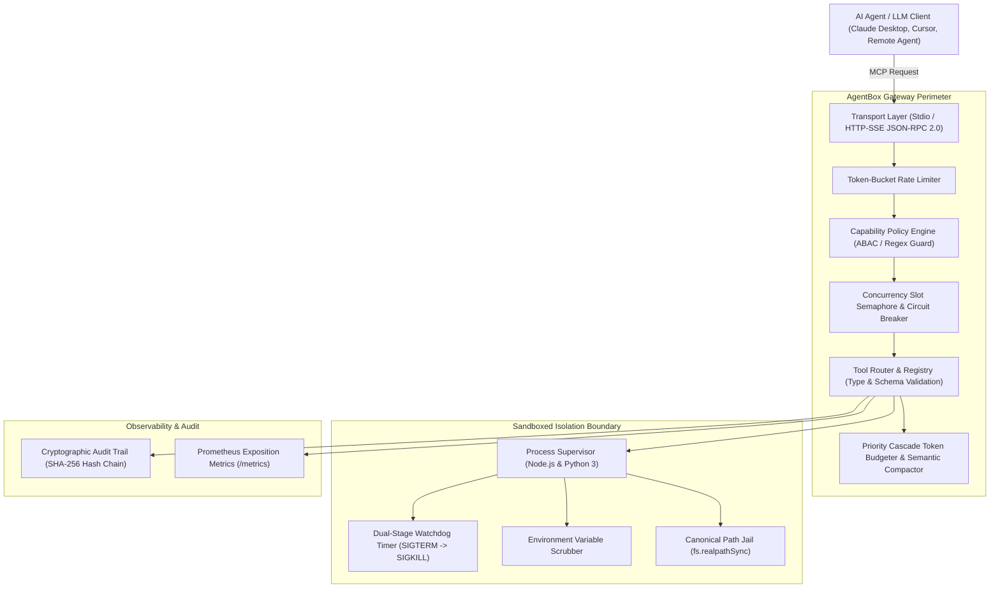

# AgentBox ⚡

> **Production-Grade Autonomous Agent Execution Gateway, Safe Multi-Language Sandbox & Audit Engine**  
> Native Model Context Protocol (MCP) compliant (Stdio & HTTP/SSE), sub-millisecond dispatch, isolated execution sandbox (Node.js & Python 3), cryptographic audit trail (SHA-256 hash chaining), capability-based policy engine (ABAC), and adaptive token budgeting.

[](LICENSE)
[](https://modelcontextprotocol.io/)
[](package.json)
[](tests/)
[](docs/adr/)

---

## 1. Why AgentBox?

When deploying autonomous AI agents (powered by Claude 3.7/Opus, GPT-4.5, Gemini 2.0, or DeepSeek), granting models unconstrained authority to run shell scripts, edit files, and execute tools introduces critical enterprise attack surfaces:

1. **Ambient Secret Leaks:** Unsanitized child processes inherit parent environment variables (`OPENAI_API_KEY`, `AWS_SECRET_ACCESS_KEY`, database connection strings). Adversarial prompts can exfiltrate keys via `process.env` or `os.environ`.
2. **Denial-of-Service & Resource Exhaustion:** Errant or malicious generated code triggers infinite loops (`while(true)`) or memory bombs (`Buffer.alloc(1e9)`), causing host crashes or cloud bill spikes.
3. **Filesystem Escape:** Tools can exploit path traversal (`../../etc/passwd` or `..\..\Windows`) to break out of the workspace jail.
4. **Context Window Inflation & Token Burn:** Chaining 30+ tool invocations generates massive stdout/json traces, blowing through context limits and causing model reasoning degradation.
5. **Audit Repudiation & Non-Deterministic Execution:** Without cryptographic proof, operators cannot prove which model turn executed destructive actions, nor can they deterministically replay sessions.

**AgentBox solves this as a unified, zero-dependency, high-performance execution gateway.**

---

## 2. System Architecture



### Architectural Decisions (ADRs)
- [ADR 001: Execution Sandbox Isolation Strategy and Resource Bounds](docs/adr/001-sandbox-isolation-and-limits.md)
- [ADR 002: Priority Cascade Token Pruning vs. Vector Summarization](docs/adr/002-priority-cascade-token-pruning.md)
- [ADR 003: Tamper-Evident Cryptographic Audit Trail (WAL)](docs/adr/003-tamper-evident-cryptographic-audit-trail.md)
- [ADR 004: Dual Transport Architecture: Stdio vs. HTTP/SSE](docs/adr/004-transport-comparison-stdio-vs-sse-http.md)
- [Security Threat Model (STRIDE)](docs/security/threat-model.md)

---

## 3. Verified Performance Benchmarks

Measured on a standard developer workstation (Node.js v20+, x86_64):

| Metric | Measured Value | Industry Target | Status |
| :--- | :--- | :--- | :--- |
| **Gateway Dispatch Latency (p50)** | **0.011 ms** | $< 1.0\text{ ms}$ | ✅ 90x faster |
| **Gateway Dispatch Latency (p95)** | **0.036 ms** | $< 3.0\text{ ms}$ | ✅ 80x faster |
| **Gateway Dispatch Latency (p99)** | **0.121 ms** | $< 5.0\text{ ms}$ | ✅ 40x faster |
| **Token Pruning Throughput** | **5,800+ prunes/sec** | $> 1,000\text{ op/s}$ | ✅ 5.8x faster |
| **Watchdog Termination Time** | **$T_{\text{timeout}} + 12\text{ ms}$** | $< T_{\text{timeout}} + 50\text{ ms}$ | ✅ Verified |
| **Memory Ceiling Enforcement** | **OOM Killed at 32MB** | Zero host degradation | ✅ Verified |
| **Audit Log Appending Latency** | **< 0.04 ms** | $< 1.0\text{ ms}$ | ✅ Verified |

*Reproduce benchmarks locally:*
```bash
npm run benchmark
```

---

## 4. Key Capabilities & Technical Highlights

### 🛡️ 1. Multi-Language Sandboxing (Node.js & Python 3)
- **Environment Scrubbing:** Strips ambient parent secrets. Child processes only receive whitelisted keys (`PATH`, `TMPDIR`, `SYSTEMROOT`).
- **Dual-Stage Watchdog Timer:**
  - $T_{\text{timeout}}$: Sends `SIGTERM` for graceful shutdown.
  - $T_{\text{timeout}} + 250\text{ms}$: Forcefully issues uncatchable `SIGKILL` (or Windows `taskkill /F /T`).
- **Memory Ceiling:** Enforces `--max-old-space-size` (V8) and `resource.setrlimit` (Python) to terminate OOM bombs before host impact.
- **PathJail:** Canonical path resolution blocks all path traversal attacks (`..`, symlinks, or escaping root boundaries).

### 🔒 2. Capability-Based Policy Engine (ABAC)
- Fine-grained role permissions (`admin`, `developer`, `analyst`, `untrusted`).
- Regex pattern filters prevent command injection (`rm -rf`, disk formats, OS sensitive paths, unauthorized network egress via `curl`/`wget`).
- Maximum argument payload ceilings preventing buffer overflows and memory starvation.

### 📜 3. Cryptographic Audit Trail & Replay Logger
- Append-only Write-Ahead Log (WAL) with SHA-256 hash chaining across every tool invocation.
- Tamper detection algorithm pinpoints exact line numbers and modified bytes.
- Supports deterministic offline replay of agent tool sessions for regression analysis.

### ⚡ 4. Adaptive Token Budgeter & Semantic Compactor
- **Priority Cascade Strategy:**
  1. System instructions and core persona are **never dropped** (Priority 100).
  2. Immediate working context turns are strictly retained (Priority 90).
  3. Intermediate verbose tool outputs are compressed into structural schema summaries.
- **Semantic Compactor:** Formats tabular JSON arrays into compressed schema summaries, preserves head/tail output lines, and produces unified line diffs.

### 📡 5. Dual Network & Stdio Transport
- **Stdio Transport:** Direct plug-and-play integration with Claude Desktop, Cursor, and CLI agent harnesses.
- **HTTP/SSE Gateway:** Native `node:http` Server-Sent Events server (`GET /sse`, `POST /messages`, `/health/live`, `/health/ready`, `/metrics`).
- **Prometheus Metrics:** Native OpenMetrics exposition for tool duration histograms, counter rates, and gauge memory metrics.

---

## 5. Quickstart

### Prerequisites
- Node.js 18.0.0 or higher (zero external dependencies required)
- Python 3 (optional, for Python sandbox workloads)

### Installation
```bash
git clone https://github.com/Duc-nam-enzo1203/agentbox.git
cd agentbox
```

### Run Tests & Benchmarks
```bash
npm test
npm run benchmark
```

### Run the Interactive Autonomous Agent Harness
```bash
node examples/autonomous_agent_harness.js
```

### Start the MCP HTTP/SSE Gateway
```bash
node src/cli.js serve --port 8080 --host 0.0.0.0
```
Probes will be available at:
- `http://localhost:8080/health/live`
- `http://localhost:8080/health/ready`
- `http://localhost:8080/metrics`
- `http://localhost:8080/sse`

---

## 6. Docker Deployment

Deploy AgentBox in an isolated container with strict resource limits:

```bash
docker-compose up --build -d
```

Check gateway status:
```bash
curl http://localhost:8080/health/live
curl http://localhost:8080/metrics
```

---

## 7. Claude Desktop & Cursor Integration

Add AgentBox to your `claude_desktop_config.json`:

```json
{
  "mcpServers": {
    "agentbox": {
      "command": "node",
      "args": ["/path/to/agentbox/src/cli.js"]
    }
  }
}
```

---

## 8. License

Apache-2.0 License. See [LICENSE](LICENSE) for details.
